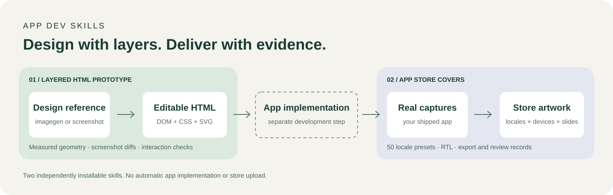

# App Dev Skills

**Turn visual references into editable app interfaces and multilingual store artwork.**

[简体中文](README.zh-CN.md) · [Quick start](#quick-start) · [Skills](#choose-your-skill) · [Examples](#example-requests) · [Contributing](CONTRIBUTING.md)

[](https://github.com/chensir-indie/app-dev-skills/actions/workflows/check.yml)
[](LICENSE)



App Dev Skills is a collection of **agent instructions plus runnable tooling** for two difficult parts of app development: faithfully rebuilding a visual concept and producing consistent store screenshots. Bring your own app, reference, language set and visual direction. Each skill works independently.

## Why this exists

A polished AI design is still a flat image. Turning it into an interface means recovering the typography, irregular shapes, asset boundaries and stacking order. Turning an app into store artwork adds another problem: keeping the same composition across different languages and devices.

This repository makes those steps explicit and reviewable:

- **Editable by construction:** DOM text, CSS/SVG panels and icons, separate image assets.
- **Evidence instead of “looks close”:** native-size browser captures, geometry checks, regional image diffs and visible interaction results.
- **Reusable across products:** project-specific branding and content, shared design tokens, configurable languages and device dimensions.
- **Clear delivery boundaries:** an automated pass is separate from visual review; a prototype is separate from a shipped app.

Built for indie developers, app teams and designers working with coding agents. Start with an approved design, an existing HTML prototype or real app captures.

## Choose your skill

| | Layered HTML prototype | App Store cover generator |
| --- | --- | --- |
| **Skill** | [`image-to-layered-html-prototype`](skills/image-to-layered-html-prototype/SKILL.md) | [`app-store-cover-generator`](skills/app-store-cover-generator/SKILL.md) |
| **Input** | Approved imagegen concepts, screenshots and optional existing HTML | Real app captures, visual reference, locale/device brief |
| **Work** | Measure → separate assets → rebuild layers → compare → refine | Match one master → localize → export matrix → review |
| **Output** | Editable HTML/CSS/SVG, design standards, assets and screenshot evidence | Editable cover project, PNGs, contact sheets and hash/review manifests |
| **Best for** | Matching typography, irregular panels, icons and occlusion | Consistent store artwork across languages and screen sizes |
| **Next step** | Optional Flutter handoff; native implementation is separate | Upload-ready assets only after product-specific review; no automatic upload |

## What each skill does

### 1. From a flat design to an editable prototype

- Extract **six levels of design standards**: art direction, tokens, layers/assets, components, pages/states and acceptance.
- Measure text layout and glyph bounds separately; record font fallback, weight, color, baseline and spacing.
- Rebuild **irregular backplates** as SVG paths and keep subjects, shadows, controls and navigation in the correct stacking order.
- Audit real DOM text, native controls, asset loading and hidden/occluded elements.
- Compare the whole image and named regions; retain native screenshots, source hashes, overlays and raw diffs.
- Track multiple pages independently, including missing evidence and unresolved visual gaps.

Whole-screen images with invisible hotspots do **not** count as editable prototypes. Generated assets are reconstructions, not guaranteed recovery of hidden original pixels.

[Workflow and setup →](skills/image-to-layered-html-prototype/README.md) · [Design-system specification →](skills/image-to-layered-html-prototype/references/design-system.md)

### 2. From app captures to localized store covers

- Build from a visual reference while keeping headlines and supporting copy editable in HTML/CSS.
- Use **50 locale presets**, custom BCP 47 targets, script-aware font stacks and right-to-left layouts.
- Maintain explicit translations and one slide order across a locale × device × slide matrix.
- Render native-size PNGs, create contact sheets and bind outputs to source hashes.
- Detect missing copy, overflow, collisions, missing assets, invalid matrices and stale exports.
- Keep human visual/translation review separate from automated export checks.

The 50 presets are available targets, not automatic production translations or a guarantee of store eligibility. The bundled demo copy is explicitly draft content.

[Workflow and setup →](skills/app-store-cover-generator/README.md) · [Localization details →](skills/app-store-cover-generator/references/localization.md)

## See the output


**Actual toolkit export of the original starter.** The UI and artwork are synthetic examples, not captures of a shipped app. This sheet demonstrates locale/device layout, not a required visual style or translation approval. See the [starter source](skills/app-store-cover-generator/assets/starter/index.html) and [export contract](skills/app-store-cover-generator/references/template-contract.md).

## Quick start

Install either or both skills, provide the relevant inputs, then invoke the skill by name. Installing instructions does not install browser or Python dependencies; those are only needed when running the bundled tools.

## Install

With the [Skills CLI](https://github.com/vercel-labs/skills), list available skills, then select either or both:

```sh
npx skills@latest add chensir-indie/app-dev-skills --list
npx skills@latest add chensir-indie/app-dev-skills --skill image-to-layered-html-prototype --skill app-store-cover-generator
```

Choose your agent when prompted. For a global Codex installation, append `-a codex -g`. Skill installation and toolkit dependency installation are separate steps.

For manual installation, clone the repository outside your agent's skills directory and copy the desired **individual** `skills/<name>` directory into its discovery directory. For Codex:

```sh
git clone https://github.com/chensir-indie/app-dev-skills.git
mkdir -p ~/.codex/skills
# First verify this destination does not already exist.
test ! -e ~/.codex/skills/image-to-layered-html-prototype && \
  cp -R app-dev-skills/skills/image-to-layered-html-prototype ~/.codex/skills/
```

Use the same approach for `app-store-cover-generator`. Preserve local changes when updating. Do not install the collection root as a single skill; it intentionally has no `SKILL.md`.

## Example requests

**Rebuild an approved interface**

```text
Use $image-to-layered-html-prototype with these three approved screenshots.
Extract shared tokens and components, then build every page as editable HTML.
Pay special attention to the irregular hero panel, plant overlap, type scale
and selected navigation pill. Show real browser screenshots and unresolved gaps.
```

**Repair an existing reconstruction**

```text
Use $image-to-layered-html-prototype to compare this HTML with the reference.
Fix the panel contour and text/icon geometry first. Preserve approved assets,
keep the original reference unchanged, and show before/after regional diffs.
```

**Create localized store artwork**

```text
Use $app-store-cover-generator with these real app captures and this reference.
Create six covers in English, Simplified Chinese and Japanese for the phone
and tablet dimensions I provide. Keep text editable, match one master before
expanding the matrix, then export and review. Stop before uploading.
```

## Run the toolkits

Requirements: Node.js 22+, Python 3.9+, npm and Playwright Chromium. From the repository root:

```sh
npm ci
python3 -m venv .venv
. .venv/bin/activate
python -m pip install -r skills/image-to-layered-html-prototype/requirements.txt
npx playwright install chromium
npm run check
```

On Linux, install browser OS dependencies with `npx playwright install --with-deps chromium`. On Windows, activate `.venv\Scripts\Activate.ps1` and provide `python3` on PATH for the npm test commands. The optional Swift/Vision OCR helper requires macOS; it is not required for core validation.

- [Layered HTML setup and commands](skills/image-to-layered-html-prototype/README.md)
- [Store cover setup and commands](skills/app-store-cover-generator/README.md)
- `npm run demo` runs the original cover demo; its UI is synthetic, not a shipped app capture.
- `npm run check` runs packaging checks, both skill test suites and real browser checks. CI only checks the toolkit; it does not package or publish mobile apps.

## How the pieces fit together

```text
Approved design → layered HTML + visual evidence
                         ↓
              App implementation and device testing
                         ↓
Real app captures → editable covers → localized exports + review
```

Use the prototype skill to establish a design and implementation reference. Build and test your app separately, then feed its real screenshots into the cover skill. Store artwork must not imply a feature the app does not have.

## FAQ

**Is this a one-click app generator?** No. These are agent workflows with measurement, reconstruction and validation tools. The agent still needs to inspect the result and fix differences.

**Do I need imagegen or an API key?** Not for existing references or the standalone toolkits. New image generation or editing uses the tools available in your agent environment, with their own access requirements and costs.

**Does this guarantee pixel-perfect reproduction?** No. Missing source assets, fonts, browser rasterization and regenerated artwork can prevent literal identity. The workflow preserves the reference, measures differences and reports unresolved areas instead of hiding them.

**Which coding agents can use it?** Each folder follows the `SKILL.md` format. Codex installation and Skills CLI discovery are verified; other supported agents can install through Skills CLI, but available image/browser tools differ by environment.

**Are all translations production-ready?** No. Presets describe locale and typography needs. Real product copy must be supplied and reviewed; the demo translations are draft examples.

**Does it publish to stores or social media?** No. Export, review, upload and publication are separate stages requiring their own authorization and verification.

## Repository layout

```text
skills/
  image-to-layered-html-prototype/  # Self-contained skill, Python + browser tools
  app-store-cover-generator/       # Self-contained skill, starter + export toolkit
scripts/                          # Collection packaging checks
tests/                            # Collection regression tests
```

This collection continues the history of `chensir-indie/app-store-cover-generator`. The cover skill name and `$app-store-cover-generator` invocation remain unchanged. Existing clones should update their remote to this repository, preserve local edits, and use `skills/app-store-cover-generator` as the toolkit working directory. Old whole-repository skill installations should be migrated to the individual skill directory; do not delete an edited installation blindly.

## Contributing and license

See [Contributing](CONTRIBUTING.md). Code, documentation and original bundled demo artwork use the [MIT license](LICENSE). User screenshots, generated artwork and third-party fonts are not implicitly licensed by this repository. See [third-party notices](THIRD_PARTY_NOTICES.md).
