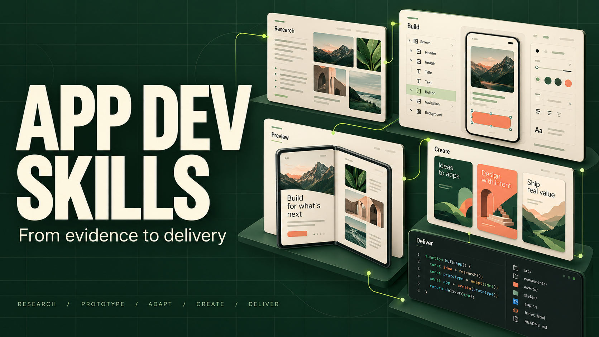
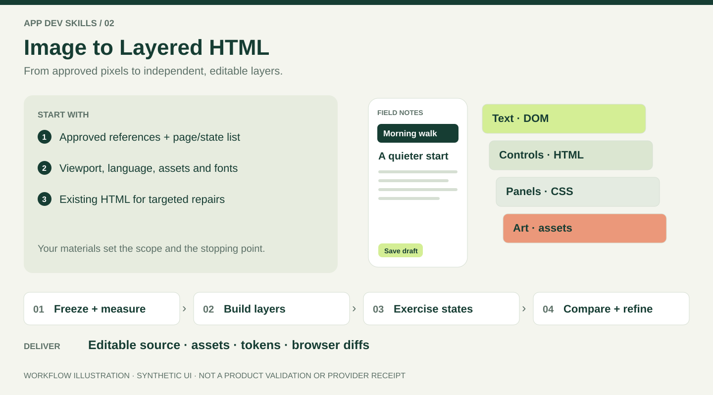
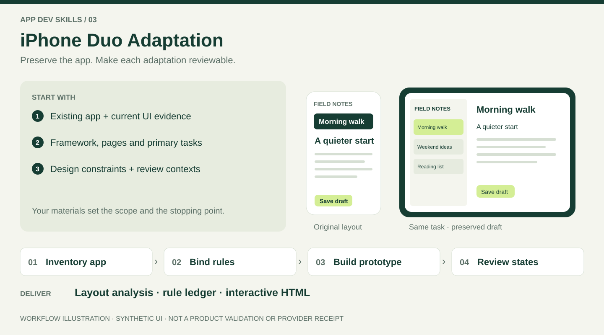

# App Dev Skills



**Reusable agent workflows for app research, editable prototypes, layout adaptation and store delivery.**

[简体中文](README.zh-CN.md) · [Choose a skill](#choose-a-skill) · [Visual walkthroughs](#see-what-each-skill-delivers) · [Get started](#get-started) · [Documentation](docs/README.md) · [Contributing](CONTRIBUTING.md)

[](https://github.com/chensir-indie/app-dev-skills/actions/workflows/check.yml)
[](LICENSE)

Turn screenshots, product questions and existing app projects into artifacts you can inspect: evidence-linked reports, editable interfaces, localized artwork and exact release records. Use one skill for the outcome you need; there is no required end-to-end pipeline.

Each folder in `skills/` is independently installable and includes its instructions, references, checks and license. Skills run through your agent and available tools; installing them does not add a model service, media generator or mobile toolchain.

## Choose a skill

| Your starting point | Skill and guide | What you receive |
| --- | --- | --- |
| Competitor screenshots, recordings, official sources or authorized artifacts | [App Competitor Analysis](skills/app-competitor-analysis/README.md) · [Agent instructions](skills/app-competitor-analysis/SKILL.md) | HTML and detailed Design.md per app, evidence-linked UI/UX analysis and feature/task/screen/data maps, plus a cross-app index |
| A design question, approved screenshots or a page to review/refine | [Image to Layered HTML Prototype](skills/image-to-layered-html-prototype/README.md) · [Agent instructions](skills/image-to-layered-html-prototype/SKILL.md) | A concept/prompt, scoped design review/refinement, or editable HTML/CSS/SVG with assets, design standards and browser comparisons |
| An iOS app on SwiftUI, UIKit, Flutter, React Native, or a WKWebView shell that needs iPhone Duo or dynamic-window adaptation | [iPhone Duo Adaptation](skills/iphone-duo-adaptation/README.md) · [Agent instructions](skills/iphone-duo-adaptation/SKILL.md) | Whole-app layout analysis, a complete rule ledger, justified minimal adaptations to the original design, and a complete HTML prototype with named Duo environments and browser comparisons |
| Real app captures, a visual reference, target languages and dimensions | [App Store Cover Generator](skills/app-store-cover-generator/README.md) · [Agent instructions](skills/app-store-cover-generator/SKILL.md) | Editable covers, a locale × device × slide PNG matrix, contact sheets and hash/review records |
| An existing app and a requested build, TestFlight upload, listing update or later store stage | [App Publish Skill](skills/app-publish-skill/README.md) · [Agent instructions](skills/app-publish-skill/SKILL.md) | Project-owned Fastlane orchestration, exact source/artifact evidence, receipt-bound TestFlight upload and separately scoped metadata, screenshots, acceptance and review stages |

Read the selected `SKILL.md` before executing its workflow. For narrower requests, existing-project repairs and stage completion, see [workflows and handoffs](docs/workflows.md).

## See what each skill delivers

The cover is AI-generated conceptual brand artwork. Below, actual toolkit output is distinguished from workflow illustrations. Each guide covers inputs, a complete walkthrough, an example task, deliverables and acceptance. Click an image to open its guide.

### 01 · Research: turn evidence into product decisions

Screenshots, recordings and a product question → evidence analysis and four maps → per-app HTML, detailed Design.md and an index.

[](skills/app-competitor-analysis/README.md#input--workflow--output)

Real renderer output; the research content is synthetic. [Inputs, complete workflow and reproduction commands →](skills/app-competitor-analysis/README.md#input--workflow--output)

### 02 · Layered HTML: turn approved pixels into editable UI

Reference images, states and assets → independent measurements, editable layers and browser comparisons → source, layer contracts and evidence.

[](skills/image-to-layered-html-prototype/README.md#input--workflow--output)

Synthetic workflow illustration, not an accepted reconstruction. [Inputs, complete workflow and how to use the result →](skills/image-to-layered-html-prototype/README.md#input--workflow--output)

### 03 · iPhone Duo: preserve the design and the user's task

An existing app, all pages and design constraints → layout analysis, rule decisions and HTML construction → a complete interactive prototype, ledger and same-state comparisons.

[](skills/iphone-duo-adaptation/README.md#input--workflow--output)

Conceptual layout illustration, not device specifications or hardware validation. [Inputs, complete workflow and acceptance →](skills/iphone-duo-adaptation/README.md#input--workflow--output)

### 04 · Store covers: scale one direction into a complete matrix

Real app captures, a reference and locale/dimension targets → master cover, localization, export and visual review → HTML/CSS, PNGs, contact sheets and a bound review.

[](skills/app-store-cover-generator/README.md#input--workflow--output)

Real export; synthetic UI and draft translations. The toolkit includes 50 locale presets. [Inputs, complete workflow and export commands →](skills/app-store-cover-generator/README.md#input--workflow--output)

### 05 · Publication: record the exact stage delivered

Project, platform/track and authorized endpoint → fresh baseline, local build and final-artifact inspection → source/artifact identity and stage-specific evidence.

[](skills/app-publish-skill/README.md#input--workflow--output)

Evidence-structure illustration, not an actual upload receipt. [Inputs, complete workflow and completion boundaries →](skills/app-publish-skill/README.md#input--workflow--output)

## Get started

### 1. Connect Codex to one source checkout

Keep the repository outside skill discovery directories and expose its `skills/` folder through one symlink. For a **new installation** on macOS, Linux or WSL:

```sh
APP_DEV_SKILLS_DIR="${HOME}/src/app-dev-skills"
mkdir -p "$(dirname "$APP_DEV_SKILLS_DIR")"
git clone https://github.com/chensir-indie/app-dev-skills.git "$APP_DEV_SKILLS_DIR"
```

Already have a checkout? Set `APP_DEV_SKILLS_DIR` to its absolute path and skip cloning. Inspect existing collection and individual entries in `~/.agents/skills` and `~/.codex/skills`; preserve local edits and move superseded copies outside both discovery directories before linking.

```sh
CODEX_SKILLS_DIR="${HOME}/.agents/skills"
mkdir -p "$CODEX_SKILLS_DIR"
if [ -e "$CODEX_SKILLS_DIR/app-dev-skills" ] || [ -L "$CODEX_SKILLS_DIR/app-dev-skills" ]; then
  printf '%s\n' 'Existing app-dev-skills entry: inspect it before changing it.'
else
  ln -s "$APP_DEV_SKILLS_DIR/skills" "$CODEX_SKILLS_DIR/app-dev-skills"
fi
```

This leaves existing entries, including broken links, untouched. Open a new Codex session if needed and verify one entry per skill resolving to this checkout. Edit and update the source; new skill folders are included automatically. [Installation, migration and other agents](docs/getting-started.md#install-and-verify-discovery).

### 2. Provide inputs and invoke the skill

For example, attach approved screenshots and ask:

```text
Use $image-to-layered-html-prototype to rebuild these approved screens as
editable HTML/CSS/SVG. Preserve the design and interactions. Show actual browser
captures, measured differences and any remaining gaps. Deliver in English.
```

Specify the source material, scope, output language and stopping point. Skill instructions and discovery metadata use English; Chinese guides and original-language evidence are retained. Deliverables can use your requested language. [Copy a task-specific prompt](docs/getting-started.md#example-requests).

### 3. Check the environment before running tools

From the installed skill's directory, run `sh scripts/doctor.sh`. It reports missing dependencies and repair commands without installing them. Follow that skill's README for scoped setup. Reading and planning can start before installing rendering tools; a full repository setup is needed only for collection development and full checks.

[Runtime requirements and troubleshooting](docs/runtime.md) · [First-use walkthrough](docs/getting-started.md#complete-a-first-task)

## What completion means

- **Research:** conclusions link to evidence; inferred technology and missing observations remain identified.
- **Prototypes:** editable source and actual browser checks support the result. Native app implementation and device acceptance are separate stages. Duo adaptation preserves the original design and defaults to layout analysis → recommendations → complete HTML prototype; it is not Apple's official App Resizability Skill.
- **Artwork:** exported files, localization checks and visual review cover the requested matrix. Exporting does not upload store assets.
- **Publication:** follow the app's current release contract and the requested endpoint. A TestFlight upload stops at Apple's successful receipt for the exact artifact; processing, tester access, review and public availability require their own evidence.

See [scope](SCOPE.md), [shared terms](GLOSSARY.md) and [workflow boundaries](docs/workflows.md) for the detailed contracts.

## Documentation and contribution

- [Documentation map](docs/README.md): user guides, technical contracts and dated validation records.
- [Contributing](CONTRIBUTING.md): repository layout, standalone packaging, language policy and verification.
- [Support](CONTRIBUTING.md#questions-and-bug-reports): troubleshooting and reproducible issue reports.
- [Security](SECURITY.md): reporting vulnerabilities without exposing private data.

## License and provenance

Original collection code, documentation and demo artwork use [MIT](LICENSE). Separately installed dependencies and user-supplied assets retain their own terms; see [third-party notices](THIRD_PARTY_NOTICES.md).

This repository continues the history of `chensir-indie/app-store-cover-generator`. Existing clones and copied installations can follow the [migration guide](docs/getting-started.md#update-or-migrate-an-installation).
