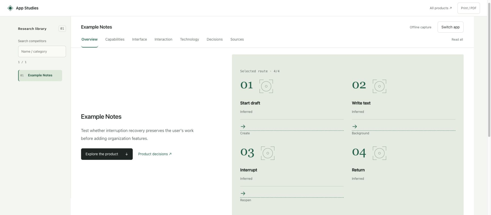
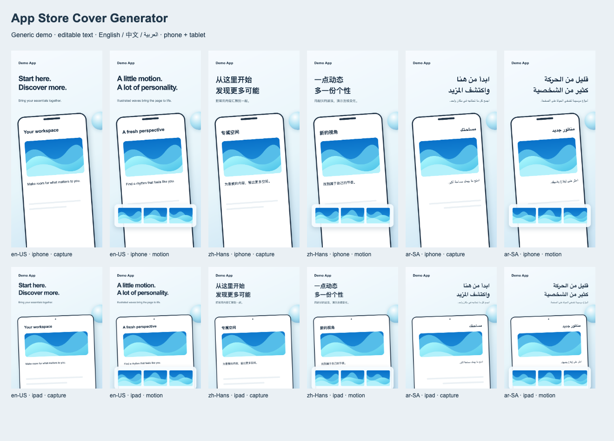

# App Dev Skills

[English](README.md)

研究竞品、还原界面、适配布局、制作商店封面、交付应用。按任务选一个技能，提供材料后直接提需求。

## 选择技能

| 你想做什么 | Skill | 产物 |
| --- | --- | --- |
| 分析竞品 | [app-competitor-analysis](skills/app-competitor-analysis/SKILL.md) | 报告与产品建议 |
| 还原或优化界面 | [image-to-layered-html-prototype](skills/image-to-layered-html-prototype/SKILL.md) | 可编辑 HTML 与浏览器对比 |
| 适配 iPhone Duo | [iphone-duo-adaptation](skills/iphone-duo-adaptation/SKILL.md) | 布局分析、建议与交互原型 |
| 制作多语言商店封面 | [app-store-cover-generator](skills/app-store-cover-generator/SKILL.md) | 可编辑封面与 PNG |
| 打包或上传应用 | [app-publish-skill](skills/app-publish-skill/SKILL.md) | 本地制品与指定阶段回执 |

## 产物预览

**竞品分析：HTML 报告**



基于虚构 Example Notes 数据生成的报告，图片为实际浏览器截图。

**商店封面：多语言、多设备**



使用示例应用界面和翻译草稿，由工具实际导出。

## 使用

安装后，附上材料或项目路径，选择下面的示例提需求。说明目标和结束阶段即可；Agent 会读取指令、检查所需环境。需要中文产物时，在请求中说明。

- `用 $app-competitor-analysis 分析这些竞品，回答［产品问题］。输出各应用 HTML 报告与对比索引，标明证据缺口。`
- `用 $image-to-layered-html-prototype 把这些截图还原成可编辑 HTML，保留原设计与主要交互，提供浏览器对比。`
- `用 $iphone-duo-adaptation 分析［项目路径］的 iPhone Duo 适配，以最小布局改动给出建议并制作完整交互 HTML 原型。`
- `用 $app-store-cover-generator 根据这些截图和文案，制作［语言和设备尺寸］的可编辑商店封面与 PNG。`
- `用 $app-publish-skill 将［项目路径］打包上传 TestFlight，拿到 Apple 上传回执后结束。`

## 安装

已连接本仓库的 Codex 无需重复安装。

<details>
<summary>首次安装或迁移时展开</summary>

### 连接一个源码目录

```sh
APP_DEV_SKILLS_DIR="${HOME}/src/app-dev-skills"
# Skip cloning if you already have a checkout; set its path above.
mkdir -p "$(dirname "$APP_DEV_SKILLS_DIR")"
git clone https://github.com/chensir-indie/app-dev-skills.git "$APP_DEV_SKILLS_DIR"
mkdir -p "$HOME/.agents/skills"
if [ -e "$HOME/.agents/skills/app-dev-skills" ] || [ -L "$HOME/.agents/skills/app-dev-skills" ]; then
  printf '%s\n' 'Existing entry: preserve edits and inspect before changing it.'
else
  ln -s "$APP_DEV_SKILLS_DIR/skills" "$HOME/.agents/skills/app-dev-skills"
fi
```

适用于 macOS/Linux/WSL。已有源码时修改路径并跳过 clone。维护源码，通过一个软链接发现技能，不向 `~/.codex/skills` 复制。迁移前保存修改，将重复副本移出发现目录；必要时新开 Codex 会话，确认每个技能只出现一次。其他 Agent 保留所选技能完整目录并加载 `SKILL.md`。

只安装单个技能时，将上方命令中的链接源改为 `skills/<name>`，链接位置改为 `~/.agents/skills/<name>`。合集与单技能安装二选一，确保每个技能只被发现一次。

</details>

[环境排查](docs/runtime.zh-CN.md) · [贡献](CONTRIBUTING.md) · [MIT](LICENSE)
