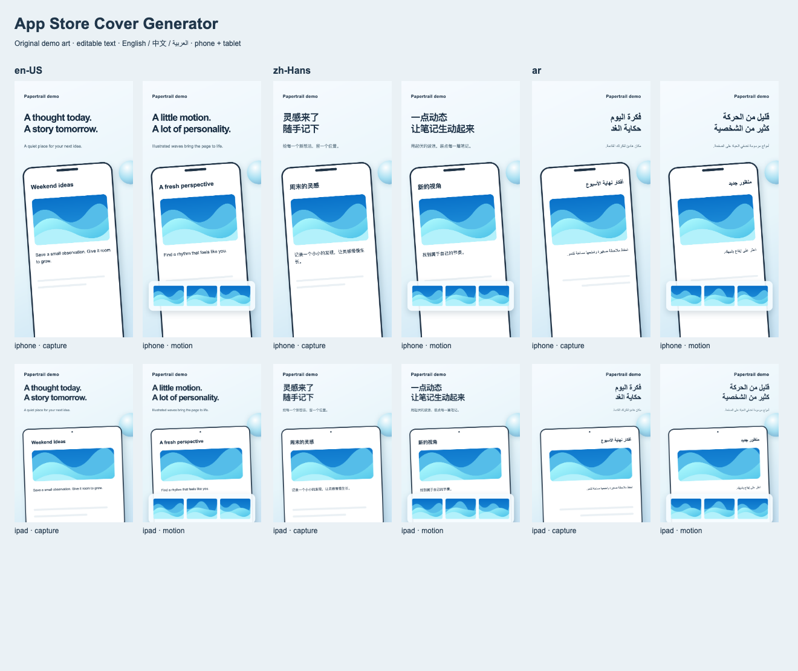

# App Store 封面生成 Skill

[English](README.md) · [Skill 指令](SKILL.md)

**把参考图和真实 App 截图，变成可编辑、可本地化、可批量导出的商店封面。**

适用于“AI 概念图很好看，网页实现却在字体、间距和细节上走样”，以及“设计定稿后，需要扩展到多语言、多设备”的场景。先对齐一张主视觉，再复用排版，导出并检查完整封面组。



这是附带的可运行示例，不是实际产品截图，也不是所有产品必须采用的风格。[查看 NextNote 案例](references/nextnote-case-study.md)。

## 安装

在项目目录运行 [Skills CLI](https://github.com/vercel-labs/skills)：

```sh
npx skills@latest add chensir-indie/app-store-cover-generator --skill app-store-cover-generator
```

按提示选择使用的 coding agent。默认安装到当前项目；添加 `-g` 可跨项目使用。例如，全局安装到 Codex：

```sh
npx skills@latest add chensir-indie/app-store-cover-generator --skill app-store-cover-generator -a codex -g
```

同一个 agent、同一个作用域选择一种安装方式即可。已手动克隆过这个 skill，请更新原有副本，避免重复安装。安装只添加指令和配套文件，不会自动安装 Chromium 或调用图片生成服务。

<details>
<summary>手动安装到 Codex</summary>

目标目录必须尚不存在；已有修改请先保留。

```sh
git clone https://github.com/chensir-indie/app-store-cover-generator.git ~/.codex/skills/app-store-cover-generator
```

没有本地修改时，可用 `git -C ~/.codex/skills/app-store-cover-generator pull --ff-only` 更新。自定义过文件时，请先审阅再合并。

</details>

通过 Skills CLI 安装的副本，可用以下命令更新：

```sh
npx skills@latest update app-store-cover-generator
```

未发现 skill 时，检查安装器显示的目标位置，并新开一个 agent 会话。不要通过重复安装来排查。

## 开始使用

附上参考图和真实 App 截图，然后告诉 agent：

> 使用 $app-store-cover-generator，根据这些截图和参考图制作六张 App Store 封面。先在相同尺寸下对齐一张主视觉，再扩展到 en-US、zh-Hans、ja、ar-SA 和指定的 iPhone/iPad 槽位。标题保持可编辑，检查溢出和动态细节，导出完整封面组，停在本地交付阶段。

检查已有设计：

> 使用 $app-store-cover-generator 检查我的封面项目。逐语言、逐设备检查字号一致性、文字裁切和翻译缺失；保留已确认的设计，只修复受影响的封面。

尽量提供真实功能、页面顺序和目标尺寸。agent 应复用已有资料，只澄清无法推断且会影响结果的决定。

## 能解决什么

| 需求           | 提供的能力                                                                   |
| -------------- | ---------------------------------------------------------------------------- |
| 复刻 AI 参考图 | 对比字号、间距、裁切和材质，单独生成复杂视觉素材                             |
| 复用网页模板   | 可编辑 HTML/CSS、独立文案、统一故事顺序                                      |
| 扩展全球语言   | 50 个 App Store 语言区域预设、自定义 BCP 47 标签、按文字系统选字体、RTL 排版 |
| 发现排版问题   | 原尺寸导出、溢出与重叠检查、实际渲染文案核对                                 |
| 检查完整封面组 | 独立 PNG、各语言设备的总览图、文件哈希清单                                   |

图片生成是可选步骤。工具本身不会调用付费 API、自动翻译你的产品、上传商店或发布社交内容。使用当前 agent 实际提供的图片工具即可。自动检查通过不代表视觉还原、翻译质量或商店审核通过。

## 语言与地区

[内置清单](assets/locales/app-store.json)覆盖截至 **2026 年 10 月 12 日** [Apple 本地化页面](https://developer.apple.com/help/app-store-connect/reference/app-information/app-store-localizations/)列出的 **50 个语言区域**。`en-US` 与 `en-GB`、`fr-FR` 与 `fr-CA`、巴西与葡萄牙葡语、简体与繁体中文都保留独立输出。

本地封面项目还支持 `fa-IR`、`sw-KE` 等自定义 BCP 47 标签。自定义语言不等于 App Store 接受对应上传槽位。国家、商店地区与语言不是一一对应关系，应选择应用实际启用的语言。

模板附带的是**三种语言的示例文案**，不是五十种已完成的翻译。扩展语言会保留已有文案，为新增语言创建空字段；补齐后才能导出，缺失内容不会悄悄回退成英文。字体按文字系统选择，但生产素材仍需提供有授权的字体并检查实际字形。参见[本地化与字体说明](references/localization.md)。

## 独立运行工具

需要 Node.js 22+、npm 和 Playwright Chromium。以下使用独立工作副本；同名目录已存在时换一个新目录。

```sh
git clone https://github.com/chensir-indie/app-store-cover-generator.git
cd app-store-cover-generator
npm ci
npx playwright install chromium
node scripts/init.mjs /tmp/my-covers
node scripts/serve.mjs /tmp/my-covers
```

打开输出的本地地址，编辑复制出的 `project.json`、`style.css` 与 `media/`。预览结束后按 Ctrl+C。Linux 可能需要 `npx playwright install --with-deps chromium`。

把所有商店语言，或指定语言列表，添加到一个**新的项目副本**：

```sh
node scripts/locales.mjs list
node scripts/locales.mjs add /tmp/my-covers /tmp/my-global-covers app-store
# 也可把 app-store 换成 ja,fr-FR,ar-SA,fa-IR。
# 补齐 /tmp/my-global-covers/project.json 中的空文案后：
node scripts/locales.mjs check /tmp/my-global-covers
node scripts/export.mjs /tmp/my-global-covers /tmp/my-global-covers-output-01
node scripts/verify.mjs /tmp/my-global-covers-output-01
```

只体验三语言示例时，直接导出 `/tmp/my-covers` 即可。初始化和导出都拒绝覆盖已有目录；每次导出使用源项目以外的新目录。

即使状态为 `automated-pass`，仍保留 `visualReview: pending`。用 `node scripts/review.mjs init OUTPUT REVIEW.json` 创建待复核记录，逐格查看总览图和原尺寸 PNG 后填写，再运行 `node scripts/review.mjs check OUTPUT REVIEW.json`。它校验记录完整性和导出哈希绑定，不能代替视觉判断。模板使用系统字体，跨操作系统可能存在像素差异；生产导出应固定有授权的本地字体。尺寸须符合 [Apple 当前截图规格](https://developer.apple.com/help/app-store-connect/reference/app-information/screenshot-specifications)。

## 文档与开发

- [参考拆解与提示词](references/art-direction.md)
- [本地化、字体与动态细节](references/localization.md)
- [项目格式与渲染接口](references/template-contract.md)
- [质量检查与局限](references/quality-gates.md)
- [商店交付边界](references/delivery.md)

```sh
npm run check
```

贡献方式见 [CONTRIBUTING.md](CONTRIBUTING.md)。CI 只验证工具，不打包或发布 App。描述和安装指引的组织方式参考了 [mattpocock/skills](https://github.com/mattpocock/skills)。

## 许可

仓库代码、文档和原创示例 SVG 采用 MIT。外部 App 截图、商标与第三方字体保留各自权利。查看 [LICENSE](LICENSE) 与 [第三方说明](THIRD_PARTY_NOTICES.md)。
