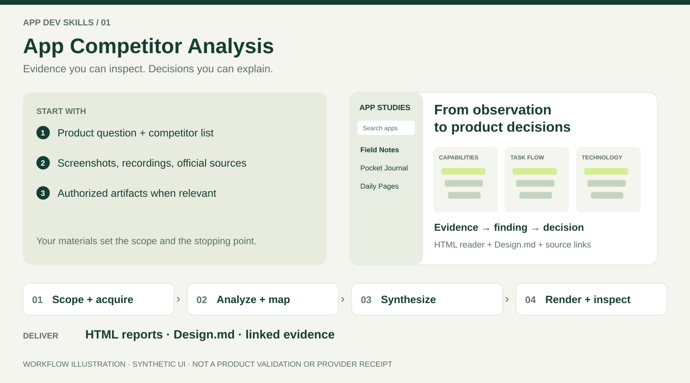

# App Competitor Analysis

[Simplified Chinese](README.zh-CN.md) · [Agent workflow](SKILL.md) · [Run the helpers](#run-the-helpers)

Explain a competitor's UI, task flow and technical capabilities from evidence, then turn the findings into product decisions. Deliver one complete HTML report per competitor and a searchable index for the full set.

A detailed interface pass also delivers a source-linked `Design.md` per competitor: visible element inventory, semantic visual rules, component states and a UX review of goals, choices, feedback, recovery and completion. HTML and Markdown are generated from the same authored records; see [design specifications](references/design-specification.md).


The generated reader uses a visual product-study layout: a searchable left library, broad evidence cover, URL-addressable analysis views and continuous reading, image-led collection and distinct capability/task/technical compositions. Visual redesign requests include actual reference / old / new HTML comparisons; shared layout changes apply to the complete requested set. See [report design](references/report-design.md) for the concrete reference-to-layout rules and rendered review loop; source images and documented crops remain independently inspectable.

## Input → workflow → output



*Workflow illustration with fictional products. The real renderer example is shown below.*

### Prepare the input

| Input | What makes it useful |
| --- | --- |
| Decision brief | Name your app, target user task and the decision this research should change. |
| Competitor inventory | List every requested app, platform and known version; identify the full set versus a sample. |
| Evidence | Attach original screenshots, recordings and official links with source/date/state. Supply authorized packages only when technical analysis needs them. |
| Delivery scope | Name dimensions, output language, sharing restrictions and any narrow stopping point. |

### Follow one complete task

Example: compare how two note apps recover an interrupted draft before deciding whether to add autosave to your own app.

| Step | Work performed | Inspectable result |
| --- | --- | --- |
| 1. Scope and acquire | Define an equivalent task; inspect available sources and pursue consequential gaps through authorized routes. | App inventory, evidence IDs, acquisition attempts and coverage gaps. |
| 2. Reconstruct | Trace entry, edits, interruption, recovery and completion; inspect visible UI and supported mechanisms. | Feature, task, screen and data maps; UI elements and UX records. |
| 3. Reason | Separate observations, official claims, static findings and hypotheses; compare alternatives and tradeoffs. | Evidence-linked findings, adopt/adapt/defer decisions and checks that could reverse them. |
| 4. Author and render | Write structured records, then generate the complete reading bundle. | One HTML per app, an index and, for a detailed UI pass, `design/<product-id>/Design.md`. |
| 5. Review | Open the actual report; exercise search, app switching, chapter links and source links; inspect desktop and phone layouts. | Browser/visual observations, remaining gaps and the complete requested set. |

### Open and use the delivery

Open `index.html`, select an app, read the relevant view and follow evidence IDs back to their sources. Keep `assets/` beside the reports for offline reading. Use the design document for interface decisions; carry hypotheses into the next implementation task as hypotheses.


*Actual Chrome capture of `assets/report-bundle.example.json` rendered on 2026-10-27. Example Notes and its findings are synthetic; this shows the reader, not research on a real competitor. Reproduce it with [Run the helpers](#run-the-helpers). The minimal fixture does not demonstrate every detailed Design.md field.*

**Done means:** every requested competitor is covered, material conclusions have evidence or explicit uncertainty, and the delivered reader has been inspected. A renderer exit or an audit alone does not establish analytical quality.


## Start with your question

| What you have | Where the analysis starts |
| --- | --- |
| Screenshots or recordings | Visible design rules, task states and consequential branches |
| Several competitors | A complete identity inventory, one report per app, then comparison by user job |
| An authorized package or source sample | Pinned static findings, call paths and alternative implementation explanations |
| Incomplete evidence | Supported findings, precise unknowns and the next useful observation |

Provide the target competitors, your product question and available artifacts. A usable brief is enough to begin; Python and device access are unnecessary for reading the supplied evidence.

```text
Use $app-competitor-analysis with these screenshots, task recordings and official
sources. Explain the UI rules, core interaction branches and supported technical
mechanisms. Relate findings to my product brief. Deliver one complete
HTML report per competitor and an index; distinguish facts, hypotheses and gaps.
```

For a narrow question, name the dimensions you need. For a full collected set, say so explicitly; deeper sampling does not replace the individual reports.

## Install

For Codex, prefer the [collection installation](https://github.com/chensir-indie/app-dev-skills#1-connect-codex-to-one-source-checkout): one symlink exposes every skill from the source checkout. If the collection is already linked, this skill needs no additional installation. To expose only this skill, first clone the repository outside discovery directories and set its absolute path below:

```sh
APP_DEV_SKILLS_DIR="${HOME}/src/app-dev-skills"
CODEX_SKILL_LINK="${HOME}/.agents/skills/app-competitor-analysis"
mkdir -p "$(dirname "$CODEX_SKILL_LINK")"
if [ -e "$CODEX_SKILL_LINK" ] || [ -L "$CODEX_SKILL_LINK" ]; then
  printf '%s\n' 'Existing skill entry: inspect it before changing it.'
else
  ln -s "$APP_DEV_SKILLS_DIR/skills/app-competitor-analysis" "$CODEX_SKILL_LINK"
fi
```

Compare existing `~/.agents/skills` and `~/.codex/skills` entries with the source, preserve local edits, and move superseded copies outside discovery directories before migration. Update the source checkout directly. Open a new Codex session if discovery has not refreshed, then check that this skill resolves to the source `SKILL.md` only once. Shell examples support macOS/Linux and WSL.

For other agents or a separate scope, use [Skills CLI](https://github.com/vercel-labs/skills) (Node.js 22.20+):

```sh
npx skills@latest add chensir-indie/app-dev-skills --skill app-competitor-analysis
```

Choose an agent/scope that does not duplicate the Codex link and preserve local edits before updating. This installer needs Node.js/npm; the analysis and bundled helpers themselves do not.

## What you receive

The index and reports share a searchable left competitor list, current-product highlight and native switching that preserves the chapter in the enhanced reader. Phones use an expandable chooser; independent offline URLs remain available.

Each product report opens with the product's main task, defining experience and key finding, supported by readable inspected imagery where available. Four evidence-linked maps explain feature hierarchy, directed task flow, screen relationships and technical data flow. Detailed findings cover the requested dimensions, operating constraints, strengths and costs, product decisions and unknowns; long evidence records remain available for inspection without dominating the reading experience. The default reading bundle stores shared images, CSS and JavaScript in a local `assets/` folder, preserving exact evidence and allowing reuse across reports. Keep the folder beside the HTML files for offline reading. Use `--format standalone` only when a single-file report is needed.

The [analysis depth contract](references/analysis-depth.md) requires consequential findings to connect evidence, mechanisms and states, causal alternatives, costs, product decisions and checks that could change those decisions. It includes an original same-evidence example and reviews for interchangeable product descriptions, repeated sections and generic maps. Missing runtime evidence remains explicit while useful conditional reasoning continues. Word counts, diagram counts and automated audits do not certify analytical depth.

The default [Apple-guided web design contract](references/apple-web-design.md) defines readable system typography, neutral surfaces, consistent spacing, usable controls and responsive maps. It adapts official design principles to explicit web choices, including 17px body text, captions of at least 13px and 44px standalone touch targets at the default browser scale. Desktop, phone, enlarged-text, keyboard and print checks accompany actual report review. An explicit user style request can override the visual direction; the contract does not claim native Apple certification.

Screenshot evidence supports visible appearance; runtime evidence supports behavior under the recorded conditions. Official claims, static findings and hypotheses retain their own labels. Missing evidence stays visible in the coverage matrix. HTML generation, source completeness and browser review are separate checks.

For a shorter editorial reading surface, author product `brief` and section `summary_blocks`; complete analysis and protocols remain accessible. See the [reading-copy review](references/design-quality-review.md#edit-the-reading-copy).

The reading layout keeps all four maps with their related explanations. Author `features.priority`, `journey.focus` and `dataflow.contract` alongside map `reading` and node `caption`. These drive task-scoped capability tiers, a primary path with explicit branches, and technical responsibility symbols with a concrete boundary. Every original node, relationship and evidence status remains inspectable. See [diagram design](references/diagram-design.md) for the schema, responsive grammar and collection checks.

## Run the helpers

Research can start immediately. Before rendering or auditing, run this read-only check **from the skill directory**:

```sh
sh scripts/doctor.sh
```

It checks `python3`, then `python`, for a runnable **Python 3.9+**. Use the command it reports in place of `python3` below. Core rendering and audits use the standard library; no pip dependencies, Node.js or browser download are required for them. Optional local preview preparation uses Pillow when available.

If Python is missing or too old, the check exits nonzero with the [official installation link](https://www.python.org/downloads/) and retry steps. Install a supported Python 3 for your platform, reopen the terminal and rerun the check. On Windows, use Git Bash or WSL for the shell check, with Python available in that shell. Continue evidence research while the environment is being prepared; keep helper-dependent delivery pending.

Render the bundled **synthetic example** into a new directory outside the installed skill:

```sh
python3 scripts/render_reports.py assets/report-bundle.example.json --output /tmp/teardown-demo --format linked
```

Choose a different new path if that directory already exists. The renderer refuses overwrites. Open `/tmp/teardown-demo/index.html` in your browser to explore the example. For real work, replace the example's authored analysis and evidence, then use a project output folder. The renderer formats your analysis; it does not discover sources or write findings.

For image-heavy reports, optionally run `python3 scripts/prepare_previews.py INPUT.json --output NEW_MEDIA_DIR --bundle-output NEW_BUNDLE.json` before rendering the new bundle. It needs Pillow in the current interpreter, preserves exact originals and records derivative hashes. Without that optional capability, the renderer uses bounded catalog images or capability summaries. See [navigation and performance](references/html-delivery.md#navigation-and-performance) for actual-file measurements and source preservation.

For structured research records:

```sh
python3 scripts/audit_evidence.py /absolute/path/to/evidence.json
python3 scripts/audit_acquisition.py /absolute/path/to/acquisition.json
```

The first audits provenance joins and coverage; the second audits evidence-gap acquisition records. Neither fetches sources or verifies the truth of a claim. See the [evidence schema](references/evidence-model.md) and [acquisition example](assets/acquisition.example.json).

Browser review uses your agent's available browser tools or a manual browser. If no browser is available, keep the generated files and report browser delivery checks as pending; a successful renderer exit does not complete them.

## Read only what the task needs

| Task | Reference |
| --- | --- |
| Scope findings and provenance | [Evidence model](references/evidence-model.md) |
| Develop findings or repair shallow reports | [Analysis depth](references/analysis-depth.md) |
| Inspect pixels and design rules | [UI analysis](references/ui-analysis.md) |
| Reconstruct tasks and states | [Interaction analysis](references/interaction-analysis.md) |
| Evaluate mechanisms and alternatives | [Technical analysis](references/technical-analysis.md) |
| Compare apps and make product decisions | [Synthesis and report](references/synthesis-and-report.md) |
| Author, render and inspect HTML | [HTML delivery contract](references/html-delivery.md) |
| Improve report presentation and review actual pages | [Design quality review](references/design-quality-review.md) |
| Apply the default design and browser checks | [Apple-guided web design](references/apple-web-design.md) |
| Review analytical completeness | [Evaluation rubric](references/evaluation.md) |

The workflow stops at analysis and report delivery. App implementation, device acceptance and publication need their own work and authorization. Access to a competitor account or artifact follows the user's existing permission.

To continue into design or implementation, reference the reports and evidence, then carry the user's chosen decisions, unresolved hypotheses and requested next artifact. Recommendations alone do not establish an approved design or a real capture of your app.

## Research methods and task records

[Decision-routed methods](references/research-methods.md) cover equivalent-task studies, heuristic issues, metrics, commercial scenarios, optional scoring and decision experiments. Use the [workbook](assets/research-workbook.md) to author actual records; preserve existing visual maps and technical analysis.

```sh
python3 scripts/study_metrics.py assets/study-record.example.json --output study-summary.json
```

The fixture is fictional. The helper checks first-valid-attempt arithmetic, not recruitment, task equivalence or usability. Planned studies have null results; do not import fixture outcomes into real reports.
