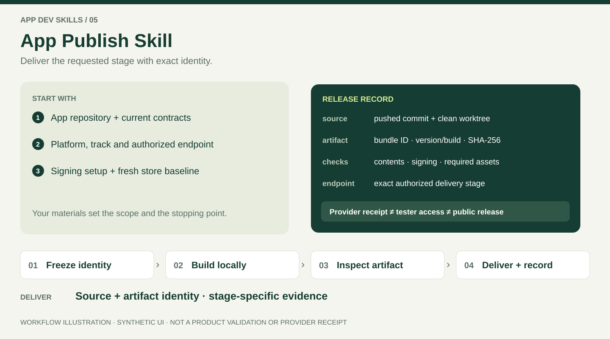

# App Publish Skill

[Simplified Chinese](README.zh-CN.md) · [Agent workflow](SKILL.md)

Coordinate local mobile packaging and staged store delivery with the project's Fastlane setup. Choose a build adapter from the actual platform and framework: native iOS Swift/SwiftUI/UIKit/Objective-C, Flutter, React Native/Expo with a supported local native project, or native Android Kotlin/Java/Gradle. The shared workflow covers a fresh store baseline, exact source identity, signing, artifact checks, TestFlight receipt, localized metadata, screenshot covers and App Review. Android delivery uses local builds and authenticated Chrome Play Console. Other frameworks need an identified, project-verified native/export adapter; this package does not claim they have all been exercised.

This package coordinates publication; the cover-generation skill or existing project artwork tools can produce editable artwork. A standalone design request does not need the whole release workflow.

## Input → workflow → output



*Illustrative evidence record. It contains no real version, upload result or provider receipt.*

### Prepare the input

| Input | What to provide |
| --- | --- |
| Project | Trusted app repository, current release contract and existing build/Fastlane adapter. |
| Intent | Platform, track, intended source/features and exact endpoint: build, TestFlight upload, listing work or a later stage. |
| Environment | Local toolchain and approved signing/credential configuration. Refer to secret paths; never paste secret values into a report. |
| Live identity | Authorized store access for a fresh baseline. A stale version in a README is not a candidate identity. |

### Follow a TestFlight upload task

| Step | Work performed | Inspectable result |
| --- | --- | --- |
| 1. Discover | Read the actual project contract, wrappers and Fastlane lanes; check relevant tools. | Adapter/toolchain diagnosis and exact authorized endpoint. |
| 2. Freeze | Read the fresh store baseline, choose the candidate under the project policy and verify the clean pushed source. | Intent, baseline time, commit, version/build, platform and track. |
| 3. Build locally | Use project-owned signing and build lanes after required preflight and tests. | Local archive/IPA and build evidence. |
| 4. Inspect | Inspect final package identity, contents, signing/configuration and required assets/data; hash the actual file. | Artifact checks and SHA-256 tied to the frozen source. |
| 5. Upload and record | Upload through the project's receipt-boundary Fastlane path; retain the exact successful Apple receipt. | `uploaded` for that artifact/version/build; stop the upload task here. |

### Read the delivery record

The result identifies the completed stage, source commit, package/bundle ID, version/build, artifact path and hash, provider receipt when applicable, check results and unresolved gates. The repository's own record format is retained; [the evidence contract](references/evidence-contract.md) describes the bundled offline helpers.

For metadata-only work, expect localized field/file diffs, previews, the exact allowlist and bound review for an existing candidate, without inventing a binary rebuild. Android uses local packaging and authenticated Chrome Play Console for the authorized store stage; do not apply the Apple upload route to Android.

**Done means:** the requested terminal stage has direct evidence. A successful TestFlight receipt means `uploaded`; processing, provider-valid, tester distribution, installability, review and public availability remain distinct. No screenshot in this guide proves a store delivery. [Read-only readiness](#read-only-readiness-and-offline-helpers) can be checked without a live upload.


## Inputs and outputs

Provide the app repository, platform/track and requested endpoint. Existing session authorization remains valid. The workflow discovers project contracts and adapters, records exact source/artifact identity, completes the authorized stage, and reports the remaining gates.

```text
Use $app-publish-skill for this app. Build and upload the current intended
candidate to TestFlight using its project-owned Fastlane workflow.
Stop after Apple's successful receipt and report the version/build, commit and IPA hash.
```

```text
Use $app-publish-skill to prepare localized metadata and the complete screenshot
cover matrix for the existing candidate. Produce previews and field/file diffs;
this request stops before uploading store materials.
```

TestFlight upload needs an explicit request naming TestFlight. A direct request already supplies that authority; the skill does not add a second confirmation after preflight. Metadata, screenshots, legal/subscription fields, tester distribution and App Review remain separate scopes. Apple public release defaults to owner-manual.

Read [SKILL.md](SKILL.md) first. For first use, a missing Fastlane command or incomplete project gems, follow [Fastlane detection, installation and recovery](references/fastlane-setup.md) before the dependent stage. Its stage table routes to [build/TestFlight](references/fastlane-build-testflight.md), [metadata/screenshots](references/metadata-screenshots.md), and [acceptance/review/Android](references/acceptance-review-android.md). [Workspace adapters](references/workspace-adapters.md) preserve dated historical lessons without treating old lane parameters or versions as current facts.

## Install from one source

The existing [collection source link](https://github.com/chensir-indie/app-dev-skills#1-connect-codex-to-one-source-checkout) discovers new skills automatically. For standalone use, keep this entire folder in one source checkout outside discovery directories and link it once into the agent skill directory. Preserve existing entries and local changes; verify one discovered entry resolving to this folder. No copied installation or separate registry is needed.

## Read-only readiness and offline helpers

From this skill directory:

```sh
sh scripts/doctor.sh
sh scripts/doctor.sh --project /path/to/app --platform ios
sh scripts/doctor.sh --project /path/to/app --platform android
# Select one adapter explicitly for a monorepo or multiple Fastlane entries:
sh scripts/doctor.sh --project /path/to/app --platform ios --fastlane-dir /path/to/app/ios/fastlane
python3 scripts/release_evidence.py --help
python3 -m unittest discover -s tests -p 'test_*.py'
```

The helpers need Python 3.9+ and only its standard library. If Python is missing or old, select a supported installation from [python.org](https://www.python.org/downloads/), reopen the terminal and rerun. No pip/npm dependencies are bundled.

The default doctor checks package resources and Python. `--project` also runs Ruby/Bundler version checks, `bundle check` and the project's `bundle exec fastlane --version` in the discovered adapter directory; an existing no-Gemfile setup is checked through its standalone Fastlane command with an unpinned-runtime warning. `--platform` selects iOS or Android; `--fastlane-dir` resolves an explicit project-local adapter instead of guessing among multiple entries. Only framework-relevant tools are checked; a native iOS or React Native project does not need Flutter. Use this check only for a trusted project: Bundler evaluates its Gemfile. Doctor does not authenticate, install, build, upload, read secret files, verify source synchronization or establish release eligibility. Use the [setup guide](references/fastlane-setup.md) to preserve existing Ruby/dependency pins, install missing dependencies or initialize a genuinely new setup in the authorized scope, then rerun the check. Actual builds require the selected project's platform/framework toolchain and signing; Android delivery additionally needs an authenticated Chrome session.

[The evidence contract](references/evidence-contract.md) documents `plan` and `verify-artifact`. `plan` calculates an offline candidate proposal from a supplied fresh normalized baseline; it neither reads a store nor reserves a build. `verify-artifact` checks file bytes against a frozen SHA-256; it does not inspect package contents, signatures or provider acceptance. Tests use temporary synthetic fixtures, with no live store writes.

The package uses [MIT](LICENSE). Creating or validating it does not build or upload any app.
