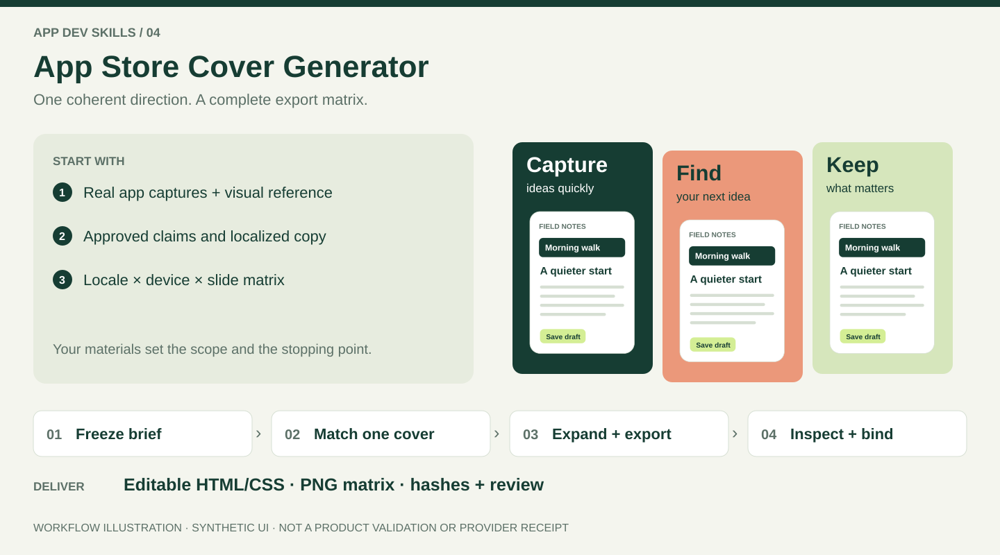

# App Store 封面生成 Skill

[English](README.md) · [Agent 指令](SKILL.md)

将真实 App 截图和视觉参考制作成可编辑、多语言的 App Store 封面。工具按语言、设备和页面矩阵导出原尺寸 PNG、总览图、文件哈希及复核记录。

## 输入 → 流程 → 交付



*上图是虚构 UI 的封面示意；下方展示工具包的实际导出。*

### 准备哪些输入

| 输入 | 需要提供什么 |
| --- | --- |
| App 内容 | 真实截图、有依据的功能主张和认可文案；只做概念时明确标注。 |
| 美术方向 | 视觉参考、品牌配色、字体/素材权利及已有认可母版。 |
| 导出矩阵 | 准确语言 ID、设备槽位/尺寸、页面 ID/顺序和目标平台。 |
| 已有工程 | 修复时提供当前项目、配置与审批历史。 |

### 一项任务如何完成

示例请求：“用这些真实截图和参考，制作 en-US、zh-Hans 各三页可编辑封面，按给定手机和平板尺寸输出，检查全部 12 张图片，先交付本地文件。”矩阵为 2 种语言 × 2 个目标尺寸 × 3 页；尺寸由项目提供。

| 步骤 | 处理什么 | 产生什么 |
| --- | --- | --- |
| 1. 冻结简报 | 核实主张、截图来源、叙事顺序、语言和尺寸。 | 简报及精确目标矩阵。 |
| 2. 匹配一张 | 渲染代表性封面，对照参考检查构图、字体和裁切。 | 可编辑母版及视觉差异记录。 |
| 3. 有意扩展 | 按语言调整文案和布局，处理长文字及适用的 RTL。 | 配置完整的源文件矩阵。 |
| 4. 导出检查 | 在新目录输出原生尺寸 PNG，检查素材、几何和文件完整性。 | PNG、联系表、清单/哈希和自动检查结果。 |
| 5. 逐张评审 | 检查每份联系表和原生 PNG，修复后重导出，把评审绑定最终哈希。 | 已评审交付及翻译、权利、槽位资格等剩余限制。 |

### 查看与使用实际输出


*真实工具导出，App UI 为合成示例，译文为草稿。它展示多语言和布局变体，不代表生产翻译已认可或尺寸已符合当前商店槽位。*

先打开联系表比较矩阵，再检查原生 PNG。修改工程的 HTML/CSS、素材和 `project.json` 后需要重新导出，因为旧评审绑定旧文件。PNG 是交付文件，可编辑源文件另行保留。按[初始化、预览、导出及评审命令](references/template-contract.md#commands)操作；starter 只是脚手架，实际项目需替换成真实 App 截图。

**完成标准：** 请求单元全部导出、检查和视觉评审，并附源码和绑定证据。联系表不是上传截图；商店上传是独立终点。只要方向的任务以概念交付结束。


## 从你的起点开始

| 已有材料 | 可以提出的任务 | 产出 |
| --- | --- | --- |
| 参考图或初步想法 | 视觉方向与提示词 | 封面概念，无需配置渲染环境 |
| App 截图与目标尺寸 | 制作可编辑封面 | HTML/CSS 项目及导出矩阵 |
| 已有封面项目 | 检查或局部修复 | 精确到矩阵单元的问题与复核结果 |

布局、品牌、页数和语言由项目决定。自动检查覆盖文案、几何、素材和完整性问题，视觉还原度与翻译质量仍需逐项检查。商店上传和社交发布需要单独授权。

本技能产出营销封面。若目标是把 App 页面重建为可点击界面，当前环境可用时先读 `image-to-layered-html-prototype`，按该目标继续。仅要方向或提示词时，停在所请求的概念产物，无需渲染环境。

## 安装与调用

Codex 使用[合集安装方式](https://github.com/chensir-indie/app-dev-skills#1-connect-codex-to-one-source-checkout)，从一个源码目录发现所有技能。已有合集链接时，本技能直接可用，无需再次安装。若只需要本技能，先把仓库克隆到技能发现目录之外，将变量设为该仓库的绝对路径，再建立软链接：

```sh
APP_DEV_SKILLS_DIR="${HOME}/src/app-dev-skills"
CODEX_SKILL_LINK="${HOME}/.agents/skills/app-store-cover-generator"
mkdir -p "$(dirname "$CODEX_SKILL_LINK")"
if [ -e "$CODEX_SKILL_LINK" ] || [ -L "$CODEX_SKILL_LINK" ]; then
  printf '%s\n' '技能入口已存在，请检查后再调整。'
else
  ln -s "$APP_DEV_SKILLS_DIR/skills/app-store-cover-generator" "$CODEX_SKILL_LINK"
fi
```

迁移前，将 `~/.agents/skills` 和 `~/.codex/skills` 中已有入口与源码比较，保存本地修改，再把淘汰的副本移到技能发现目录之外。后续只维护和更新源码仓库，Codex 直接读取它。发现尚未刷新时开启新会话，确认本技能只出现一次且解析到源码 `SKILL.md`。以上 shell 示例适用于 macOS/Linux 和 WSL。

其他 Agent 或独立范围可使用 [Skills CLI](https://github.com/vercel-labs/skills)，安装器需要 Node.js **22.20+** 和 npm/npx；工具本身要求 Node 22+：

```sh
npx skills@latest add chensir-indie/app-dev-skills --skill app-store-cover-generator
```

选择不与 Codex 链接重复的 Agent 和范围。CLI 安装可用 `npx skills@latest update app-store-cover-generator` 更新；先保存本地修改。

最小输入：应用与有依据的功能说明、真实截图（或明确要求制作概念）、参考图或设计方向、目标语言与设备尺寸、期望完成的阶段。例如：

> 使用 $app-store-cover-generator，根据这些截图和参考图，为 zh-Hans、en-US 制作指定 iPhone 尺寸的可编辑封面，导出矩阵并完成视觉复核，停在本地交付。

## 执行脚本前检查环境

安装 Skill 会添加指令和文件；渲染还需要 **Node.js 22+、npm、Playwright 和可启动的浏览器**。检查入口使用 POSIX `sh`，支持 macOS/Linux；Windows 请使用 WSL。进入已安装的 `app-store-cover-generator` 目录：

```sh
sh scripts/doctor.sh
# 仅检查运行时与依赖包；此结果不代表浏览器已可用：
sh scripts/doctor.sh --scope core
```

这个 shell 入口在缺少 Node/npm 时也能给出引导。它列出实际检查与精确修复命令，缺项时返回非零状态，不会自动安装软件。独立安装的 Skill 按提示在本目录执行 `npm install`；集合源码检出则在仓库根目录执行 `npm ci`。浏览器安装、Linux 系统库修复与 `PLAYWRIGHT_CHANNEL=chrome` 用法见[工具环境指南](references/template-contract.md#environment-check-and-setup)。

检查通过后，按[命令指南初始化、预览与导出](references/template-contract.md#commands)。交付包含可编辑源码、PNG、总览图、manifest/哈希和绑定该次导出的复核记录。自动导出通过后仍需视觉复核。

仅新项目从 starter 初始化；已有项目保留配置、素材、矩阵与审批历史，只修改请求的矩阵单元或共享源码，再更新受影响证据。后续交接引用项目/导出目录，附应用、下一阶段、矩阵、截图来源、最终哈希、绑定复核和待处理单元。概念图和原型截图导出后仍保留其身份。

## 按任务继续

- [参考还原与视觉方向](references/art-direction.md)
- [语言扩展、字体与 RTL](references/localization.md)
- [环境、项目结构与命令](references/template-contract.md)
- [质量校验、视觉复核与故障排查](references/quality-gates.md)
- [商店交接与发布边界](references/delivery.md)
- [开发与贡献](CONTRIBUTING.md)

采用 [MIT](LICENSE) 许可。外部截图、商标与字体保留各自权利，详见[第三方说明](THIRD_PARTY_NOTICES.md)。
